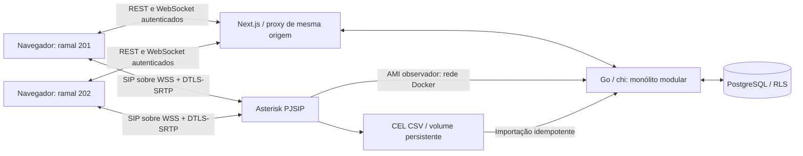

# Arquitetura — Fase 01

Para o estado atual com filas, horários e transferência, consulte [Arquitetura da Fase 02](FASE-02-ARQUITETURA.md). Este documento descreve a baseline da Fase 01.

Monólito modular, exclusivo para desenvolvimento local. Produto horizontal B2B, sem domínio de saúde.

O backend não recebe áudio. SIP.js sinaliza diretamente ao Asterisk. Mídia é DTLS-SRTP entre navegador e Asterisk, sem mídia direta entre ramais. WSS publicado somente no loopback; AMI e PostgreSQL não têm portas no host. Nenhum tronco ou destino externo.

## Módulos

- `identity`: duas identidades de desenvolvimento por tokens aleatórios, com principal e tenant definidos no servidor; terceiro token somente para testes de isolamento. Cookie HttpOnly criado após troca de token.
- `tenants`: limite organizacional; transações com `set_config(..., true)` e políticas RLS em todas as tabelas. Papel não proprietário e sem superuser.
- `extensions`: dois ramais provisionados por arquivos, sem API administrativa nesta fase.
- `telephony`: adaptador Asterisk, leitor AMI com timeout/reconexão, snapshots de contatos/canais, importador CEL. `Observer` é o contrato de status da API; não generaliza comandos não implementados.
- `calls`: sessões, pernas e eventos. `asterisk_linked_id` correlaciona sessão; `asterisk_unique_id`, cada canal. Modelo permite múltiplas pernas; transferências não são implementadas.
- `realtime`: WebSocket com eventos persistidos, cursor sequencial, origem validada, ping e reconexão do navegador. Consumo por pelo menos uma entrega; cliente descarta sequências repetidas e reconsulta o estado REST.
- `integrations`: limite reservado, sem implementação comercial.
- `audit`: tabela reservada; não existem operações administrativas de alteração nesta fase.

## Consistência

CEL é o diário persistente do motor. Varredura a cada segundo, chave SHA-256 determinística, transação para agregado/perna/evento. Eventos AMI `Newstate/Ringing` complementam o diário e são deduplicados pelo canal/estado. Estado terminal não regride por chegada tardia; uma resposta atrasada corrige `failed` para `completed` mantendo o encerramento. Transações serializadas por tenant asseguram que o cursor de eventos respeite a ordem de commit. A importação de eventos não depende de Redis.

Snapshots `PJSIPShowContacts` e `CoreShowChannels` são solicitados a cada cinco segundos. Após período de 15 segundos, sessão sem canal ativo é marcada `interrupted`, sem inventar sucesso. Um encerramento posterior encontrado no CEL restabelece o desfecho conhecido. A reconciliação de contatos gera eventos somente na mudança de estado. Não há retenção durável de cada transição de registro durante queda do observador.

Limites deliberados: reprocessamento integral do CSV, teto de 32 MiB e um importador/instância backend. Em escala comercial, cursor de arquivo persistido, rotação com confirmação e ingestão transacional dedicada devem preceder expansão. Disco/volume perdido ou SIGKILL antes de flush do Asterisk pode perder dados ainda não gravados; não há garantia de exactly-once no motor.

## Decisões

Sem Redis, ARI, originação REST, microsserviços, filas, faturamento ou provisão dinâmica. Discagem é SIP.js; não existe `POST /v1/calls`. pgx é usado nas transações e queries agregadas; sqlc gera as leituras de ramais a partir de SQL versionado. Evoluir outras consultas para sqlc conforme o módulo crescer.
