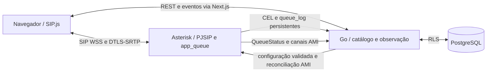

# Fase 02 — Arquitetura efetiva

O monólito Go administra o catálogo e guarda a intenção do operador. PostgreSQL aplica RLS e chaves estrangeiras compostas por tenant. Asterisk decide registro, toque, seleção, ponte e mídia. O discador Next.js mantém o SIP.js montado ao navegar dentro da tela. Não há proxy de mídia Go, ARI, Docker socket na aplicação ou motor de filas paralelo.

## Configuração e operação

- Migração 002: departamentos, filas e vínculos. Os departamentos de exemplo são dados iniciais, removíveis. Cada departamento tem no máximo uma fila nesta fase; a associação do ramal é feita pelo vínculo da fila.
- Migração 003: ramal 203, necessário para validar três participantes reais. Preserva 201/202 e suas credenciais. Os três ramais continuam configurados no PJSIP; cadastro e revogação comercial de endpoints não fazem parte do provisionamento local.
- O controlador lê o catálogo do tenant cujo contexto PJSIP está provisionado, escreve configurações validadas em volume privado e recarrega os módulos app_queue e pbx_config. Uma rota 3xx só existe se gerada para uma fila. Filas usam nome qualificado por tenant e membros PJSIP conhecidos. Sem curinga de saída pública nem contexto external_replaces.
- O reconciliador compara QueueStatus com a intenção persistida, aplica QueueAdd, QueueRemove ou QueuePause e consulta novamente. Contato alcançável, estado de dispositivo e pausa do motor determinam disponibilidade; uma leitura vencida é desconhecida. Reinício limpa membros dinâmicos e a reconciliação repõe a intenção no banco.
- ringall chama os membros elegíveis em paralelo; rrmemory retoma o rodízio a partir da última posição; fewestcalls prioriza quem atendeu menos chamadas naquela fila. Elegibilidade usa ringinuse=no e os estados do Asterisk. O prazo total é checado pelo Asterisk entre tentativas; pode exceder o valor nominal até o fim do ciclo.
- PUT para configurações e presença é convergente: repetir o mesmo conteúdo não duplica a associação. Auditoria registra ação, alvo, ator e correlation ID. HTTP 202 indica intenção persistida; o cliente observa o snapshot. A credencial controladora AMI é separada da observadora e fica no servidor. As classes AMI não são ACL por ação; comprometer o backend expõe privilégios mais amplos que a API Go oferece. O socket segue privado.
- Só existe um tenant de telefonia provisionado. Outro tenant autenticado não pode escrever configurações do PBX, ver membros ou receber eventos da operação. Antes de provisionar segundo tenant são obrigatórios endpoints distintos, mapeamento de canal para tenant e dialplan/transferência por contexto. O prefixo da fila sozinho não resolve esse limite.

## Espera e transferência

- Espera: re-INVITE SDP com modificador de hold do SIP.js. O navegador corta a track do microfone durante espera e negociação; a retomada depende da resposta ao re-INVITE. Não foi adicionada música.
- Direta: REFER com URI interna. Assistida: espera na sessão original, nova sessão de consulta, REFER com Replaces após atendimento. Cancelar ou rejeitar encerra a consulta e solicita retomada da sessão original.
- Asterisk res_pjsip_refer executa a transferência. Resposta ao REFER não comprova atendimento no destino; o cliente acompanha NOTIFY sipfrag e distingue aceito, falha e sem confirmação. A confirmação de conexão entre participantes vem da ponte, da mídia e dos eventos persistidos.
- CEL mantém BLINDTRANSFER e ATTENDEDTRANSFER com detalhes selecionados, como canal/ID do participante e ponte. O parser aceita os registros históricos de 9 colunas e os novos de 10. A sessão mantém a rota original. Uma consulta assistida pode ter sessão própria.

Referências: [Queue() do Asterisk 20](https://docs.asterisk.org/Asterisk_20_Documentation/API_Documentation/Dialplan_Applications/Queue/), [transferências PJSIP](https://docs.asterisk.org/Configuration/Channel-Drivers/SIP/Configuring-res_pjsip/res_pjsip-Remote-Attended-Transfers/), [especificação CEL](https://docs.asterisk.org/Configuration/Reporting/Channel-Event-Logging-CEL/CEL-Specification/).

## Supervisão e histórico

- O painel consulta snapshots recentes do Asterisk. Canais ativos são agrupados por LinkedID; uma ligação com duas pernas conta uma vez. Ramais conectados são contatos PJSIP alcançáveis. A fila e os membros são observados em QueueStatus; ausências ou leitura vencida ficam explícitas.
- Disponíveis, ocupados e pausados são ramais distintos presentes nas filas, com precedência ocupado > disponível > pausado quando há mais de uma associação. Um ramal SIP registrado pode estar fora da distribuição. Ligações ativas incluem toque, fila e conversação no snapshot. Aguardando é a soma de chamadas nos snapshots das filas. Departamento com fila ativa é o departamento com fila presente no motor.
- A migração 004 guarda eventos de queue_log em PostgreSQL. As métricas das últimas 24 horas contam chamadas distintas com CONNECT; ABANDON conta somente se não houver CONNECT na janela. A espera média usa a menor espera de CONNECT por chamada (se transferida entre filas), em segundos. Fallback direto que atende é chamada atendida, mas não incrementa “Atendidas pela fila”. Falta de diário saudável oculta os totais históricos no painel.
- Uma chamada permanece com a rota de origem. Departamento, fila e atendente na listagem representam o primeiro percurso registrado; detalhes incluem outras passagens e transferências. O filtro de departamento/atendente usa a classificação principal. Se o catálogo foi apagado antes da importação, o departamento pode ficar desconhecido. Duração do queue_log é preferida para conversa da fila; fora dela, é o intervalo atendimento–término (pode incluir espera durante a conversa). Canal sem causa registrada não recebe uma causa inferida.
- Histórico mantém o estado da Fase 01 e acrescenta o desfecho. Rejeitada/ocupada/falha dependem da causa Q.850 do canal de origem; abandonada/timeout vêm do diário da fila. Um redirecionamento sem atendimento posterior não apaga o fato de que a chamada original já foi atendida. Cada destino e tentativa deve ser lido na linha de eventos/pernas.
- CEL e queue_log permanecem no volume existente, com chaves de replay idempotentes. Leitura revarre arquivos com limite de 32 MiB cada; rotação com checkpoint, retenção, cópia de segurança e recuperação em caso de perda de disco precisam ser tratados antes de produção. Métricas têm atraso de segundos e não são uma trilha de faturamento.

## Horário e contingência

A migração 005 guarda dias da semana, horário de abertura/fechamento, fuso IANA e alternativa interna. GotoIfTime avalia os horários no Asterisk; o fuso do exemplo é America/Sao_Paulo. Sem horário salvo, a fila está aberta. O fechamento é exclusivo e o intervalo não cruza a meia-noite. O destino de fechado e o fallback de fila cheia, vazia ou vencida são ramais permitidos do tenant ou encerramento. O diário distingue rota fechada, contingência e o QUEUESTATUS observado. Feriados, múltiplas janelas por dia e escala clínica não foram implementados.
